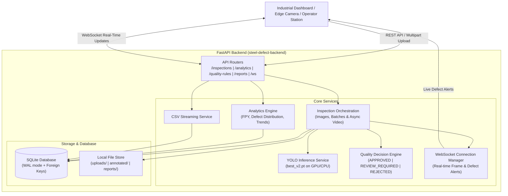

# Industrial AI Steel Surface Defect Detection Platform - Backend

Enterprise-grade, lightweight FastAPI backend integrating trained YOLO11n object detection (`best_v2.pt`) for real-time hot-rolled steel surface defect inspection and quality decision automation.

---

## 1. System Architecture



---

## 2. Key Features

1. **Trained YOLO Integration (`best_v2.pt`)**:
   - Preserves all **six NEU-DET defect classes**:
     - `0: crazing`
     - `1: inclusion`
     - `2: patches`
     - `3: pitted_surface`
     - `4: rolled-in_scale`
     - `5: scratches`
   - Real-time inference on CPU and CUDA GPUs (auto-detected with manual override).
   - Generates high-contrast annotated images and video frames with defect bounding boxes, confidence tags, and industrial status HUD.

2. **Inspection Management**:
   - Single image upload with immediate synchronous inference.
   - Batch image upload for multi-strip roll processing.
   - Video upload with asynchronous frame-by-frame background processing.
   - Inspection history with pagination and dynamic filtering (decision, status, defect type, date range).
   - Media streaming endpoints for original and annotated files.

3. **Automated Quality Decisions**:
   - **`APPROVED`**: Zero defects detected above baseline confidence, or minor indications well within metallurgical tolerance.
   - **`REVIEW_REQUIRED`**: Borderline or low-severity defects (e.g. minor scratches/crazing) requiring human quality inspector verification.
   - **`REJECTED`**: High-confidence critical defects (e.g. `rolled-in_scale`, `inclusion`, `pitted_surface`), excessive defect count, or confidence >= 70%.
   - Fully configurable thresholds and defect rules via API and SQLite.

4. **Reliable SQLite Database**:
   - High-concurrency WAL mode (`journal_mode=WAL`), `PRAGMA synchronous=NORMAL`, and foreign key cascade deletion.
   - Tracks inspections, defect bounding boxes, batches, and quality rules.
   - Thread-safe transaction management.

5. **Actual Production Analytics (No Mock Data)**:
   - **First-Pass Yield (FPY)**: `(Approved Inspections / Completed Inspections) * 100`
   - **Rejection Rate**: `(Rejected Inspections / Completed Inspections) * 100`
   - **Defect Distribution**: Count, percentage share, and average confidence per NEU-DET class.
   - **Defect Trends**: Daily inspection counts, decisions, and yield percentages.

6. **Real-Time WebSockets**:
   - Channel subscriptions: specific inspection (`/ws/inspections/{id}`) and global plant floor feed (`/ws/inspections`).
   - Frame-by-frame progress updates, FPS calculation, and live defect alerts (`DEFECT ALERT` vs `NO HIGH-CONFIDENCE ALERT`).

7. **Audit-Ready Reports**:
   - Streamed CSV download (`/api/v1/reports/csv`) supporting date ranges and decision filters.

---

## 3. Directory Layout

```
steel-defect-backend/
├── app/
│   ├── config.py                 # App settings, paths, NEU-DET class definitions, color mappings
│   ├── database.py               # SQLite initialization, WAL mode, transaction context manager
│   ├── main.py                   # FastAPI initialization, CORS, lifespan, exception handlers
│   ├── models/
│   │   └── schemas.py            # Pydantic schemas (DefectDetection, InspectionResponse, Analytics, etc.)
│   ├── services/
│   │   ├── yolo_service.py       # YOLO11n inference, GPU/CPU detection, HUD annotations
│   │   ├── quality_service.py    # Industrial classification engine (APPROVED, REVIEW_REQUIRED, REJECTED)
│   │   ├── inspection_service.py # Image/batch/video processing, disk storage, background tasks
│   │   ├── analytics_service.py  # Real SQL aggregation for FPY, distribution, and trends
│   │   ├── report_service.py     # Streaming CSV generator
│   │   └── websocket_manager.py  # WebSocket connection manager
│   └── routers/
│       ├── inspections.py        # Upload, inspection details, history, media streaming
│       ├── analytics.py          # Overview, defect distribution, trends
│       ├── quality_rules.py      # GET/PUT quality thresholds & rules
│       ├── reports.py            # Download CSV inspection report
│       └── websockets.py         # WebSocket live streaming endpoints
├── weights/
│   └── best_v2.pt                # Trained YOLO11n model weights (5.5 MB)
├── storage/
│   ├── uploads/                  # Raw uploaded images and videos
│   ├── annotated/                # Annotated media with visual bounding boxes
│   ├── reports/                  # Generated audit exports
│   └── steel_inspections.db      # SQLite database
├── samples/                      # Real industrial steel test frames and short test video
├── tests/
│   ├── test_inference.py         # Tests YOLO loading and sample inference
│   ├── test_quality_rules.py     # Tests quality decision engine
│   ├── test_database.py          # Tests SQLite schemas and cascading deletes
│   ├── test_api.py               # End-to-end integration tests for all endpoints
│   └── test_websocket.py         # Tests WebSocket connections and ping/pong
├── run.py                        # Uvicorn entrypoint launcher
├── requirements.txt              # Production dependencies
└── README.md
```

---

## 4. Quickstart

### Prerequisites
- Python 3.10+ (tested on Python 3.14)
- PyTorch and OpenCV

### Run the Server
```bash
# From the project directory:
python run.py
```
The server will start at `http://0.0.0.0:8000`.

- Interactive Swagger Docs: **`http://localhost:8000/docs`**
- ReDoc Documentation: **`http://localhost:8000/redoc`**
- System Health Check: **`http://localhost:8000/health`**

---

## 5. API Reference & Examples

### 1. Single Image Inspection
```bash
curl -X POST "http://localhost:8000/api/v1/inspections/upload/image" \
  -F "file=@samples/sample_frame_patches.jpg" \
  -F "conf_threshold=0.25" \
  -F "device=cpu"
```

**Response (`200 OK`):**
```json
{
  "id": "e81d867c-9b7e-40d3-a3d2-2826620583f7",
  "file_name": "sample_frame_patches.jpg",
  "file_type": "image",
  "status": "COMPLETED",
  "quality_decision": "REVIEW_REQUIRED",
  "decision_reason": "Minor surface defects detected within acceptable tolerance limits (patches: 1, max conf: 49.8%). Quality inspector review recommended.",
  "total_defects": 1,
  "max_confidence": 0.498,
  "inference_time_ms": 124.5,
  "defects": [
    {
      "class_id": 2,
      "class_name": "patches",
      "confidence": 0.498,
      "bbox": {
        "x1": 512.4,
        "y1": 180.2,
        "x2": 720.6,
        "y2": 395.1,
        "width": 208.2,
        "height": 214.9,
        "area": 44742.18
      },
      "frame_number": 0
    }
  ],
  "annotated_url": "/api/v1/inspections/e81d867c-9b7e-40d3-a3d2-2826620583f7/annotated-file",
  "original_url": "/api/v1/inspections/e81d867c-9b7e-40d3-a3d2-2826620583f7/original-file"
}
```

### 2. Batch Image Inspection
```bash
curl -X POST "http://localhost:8000/api/v1/inspections/upload/batch" \
  -F "files=@samples/sample_frame_crazing.jpg" \
  -F "files=@samples/sample_frame_normal.jpg" \
  -F "batch_name=Shift-1 Coil Strip 42"
```

### 3. Video Inspection (Background Processing + WebSockets)
```bash
curl -X POST "http://localhost:8000/api/v1/inspections/upload/video" \
  -F "file=@samples/sample_inspection_short.mp4" \
  -F "stride=2"
```

Connect via WebSocket to monitor video progress in real time:
```javascript
const ws = new WebSocket("ws://localhost:8000/ws/inspections/{inspection_id}");
ws.onmessage = (event) => {
  const msg = JSON.parse(event.data);
  console.log("Progress:", msg.data.progress_percent, "% | Defects:", msg.data.current_defects_found);
};
```

### 4. Production Analytics
```bash
# Overall Quality KPIs (FPY, Rejection Rate, Defect Rates)
curl "http://localhost:8000/api/v1/analytics/overview"

# Defect Distribution across the 6 NEU-DET Classes
curl "http://localhost:8000/api/v1/analytics/defect-distribution"

# Historical Defect & Yield Trends
curl "http://localhost:8000/api/v1/analytics/trends?days=30"
```

### 5. Downloadable Audit CSV Report
```bash
# Download complete inspection log as CSV
curl "http://localhost:8000/api/v1/reports/csv?quality_decision=REJECTED" -o rejected_inspections.csv
```

### 6. Configurable Quality Decision Rules
```bash
# Inspect active rules
curl "http://localhost:8000/api/v1/quality-rules"

# Update quality thresholds
curl -X PUT "http://localhost:8000/api/v1/quality-rules" \
  -H "Content-Type: application/json" \
  -d '{
    "rule_name": "Strict Aerospace Standard",
    "confidence_threshold": 0.20,
    "review_confidence_min": 0.20,
    "critical_confidence_threshold": 0.45,
    "reject_confidence_threshold": 0.65,
    "max_allowed_defects": 1,
    "critical_defects": ["rolled-in_scale", "inclusion", "pitted_surface"],
    "per_defect_tolerances": {"crazing": 1, "inclusion": 0, "patches": 1, "pitted_surface": 0, "rolled-in_scale": 0, "scratches": 1}
  }'
```

---

## 6. Running the Test Suite

All unit and integration test suites run against actual SQLite and the real YOLO model:

```bash
# 1. Test YOLO Model Loading & Real Inference
python tests/test_inference.py

# 2. Test Quality Classification Engine Rules
python tests/test_quality_rules.py

# 3. Test SQLite Schema, Foreign Keys & Transactions
python tests/test_database.py

# 4. Test FastAPI Endpoints (Upload, Batch, Analytics, CSV)
python tests/test_api.py

# 5. Test WebSocket Live Streaming
python tests/test_websocket.py
```
